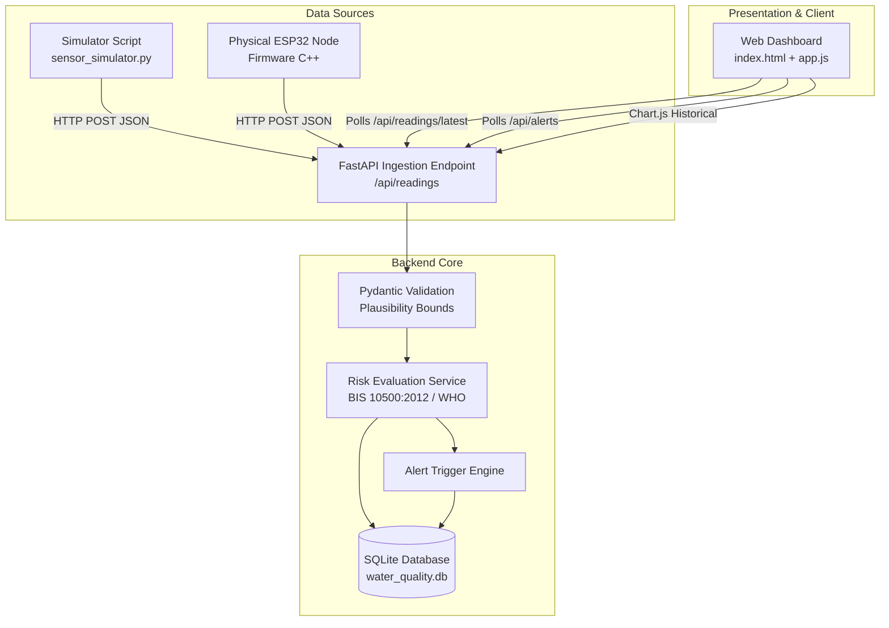

# AquaWatch Architecture & Technical Specification

## 1. High-Level System Architecture

## 2. Water Quality Reference Criteria & Jurisdictions

| Parameter | Unit | Acceptable Limit | Permissible Limit | Regulatory Reference | Health / Environmental Rationale |
| :--- | :--- | :--- | :--- | :--- | :--- |
| **pH** | -- | 6.5 – 8.5 | No relaxation | BIS IS 10500:2012 | Extremes cause mucosal irritation, corrode distribution pipes, or disrupt cellular processes. |
| **Turbidity** | NTU | &le; 1.0 NTU | &le; 5.0 NTU | BIS IS 10500:2012 / WHO | Colloidal particles shield harmful microbes from UV and chemical chlorination disinfection. |
| **Water Temp** | °C | 15.0 – 35.0 °C | Contextual | WHO Ambient Guidelines | High temperatures lower oxygen solubility and accelerate bacterial multiplication. |
| **Dissolved Oxygen**| mg/L | &ge; 6.0 mg/L | &ge; 4.0 mg/L | CPCB Surface Water Class C | Depletion (< 4.0 mg/L) induces acute hypoxic asphyxiation in fish and aquatic organisms. |

## 3. Scientific Transparency & Non-Potability Disclaimer

> [!CAUTION]
> **Important Scientific & Health Disclaimer:**
> Monitoring pH, turbidity, temperature, and dissolved oxygen allows real-time early detection of gross physicochemical disruption and surface runoff.
> **However, these four sensors alone DO NOT prove water potability.**
> Contaminants such as heavy metals (Arsenic, Lead, Mercury), chemical residues (pesticides, PFAS), and pathogenic bacteria (e.g., *Escherichia coli*, *Vibrio cholerae*) cannot be measured with standard electrochemical probes and require certified laboratory microbiological and spectroscopic assay.
